# Задание 2. Динамическое масштабирование контейнеров

Тестовое приложение `ghcr.io/yandex-practicum/scaletestapp`: `GET /` возвращает идентификатор пода, `GET /metrics` отдаёт метрики в формате Prometheus, в том числе счётчик запросов `http_requests_total`. Оба метода на порту 8080.

| Файл | Содержимое |
| :- | :- |
| [deployment.yaml](deployment.yaml) | Deployment: 1 реплика, лимит памяти 30Mi, запрос памяти 10Mi, аннотации `prometheus.io/*` для сбора метрик |
| [service.yaml](service.yaml) | Service типа NodePort для `minikube service scaletestapp --url` |
| [hpa-memory.yaml](hpa-memory.yaml) | Часть 1: HPA по утилизации памяти 80%, от 1 до 10 реплик |
| [hpa-rps.yaml](hpa-rps.yaml) | Часть 2: новая версия HPA по RPS на под, цель 10 RPS, от 1 до 10 реплик |
| [prometheus-adapter-values.yaml](prometheus-adapter-values.yaml) | Правило prometheus-adapter: из `http_requests_total` получается метрика `http_requests_per_second` |
| [locustfile.py](locustfile.py) | Сценарий нагрузки из задания |
| `part1-*.png`, [part1-hpa.log](part1-hpa.log) | Скриншоты дашборда и Locust, лог HPA части 1 |
| `part2-*.png`, [part2-hpa.log](part2-hpa.log) | Скриншоты Prometheus, дашборда и Locust, лог HPA части 2 |

HPA считает утилизацию памяти от `requests`. Если задать только лимит, запрос равен лимиту 30Mi. Под нагрузкой 300 пользователей под занимал около 18Mi, это 60%, и порог 80% не достигался. С запросом 10Mi утилизация в покое 47%, а под нагрузкой выше 80%.

## Запуск

Проверялось на minikube v1.38.1, Kubernetes v1.35.1, Helm v4.3.0, locust 2.47.0. Команды выполняются из каталога `Task2`.

### Часть 1. Масштабирование по памяти

```shell
minikube start --driver=docker --cpus=4 --memory=6g
minikube addons enable metrics-server
kubectl apply -f deployment.yaml -f service.yaml -f hpa-memory.yaml
minikube service scaletestapp --url
```

Нагрузка: 300 пользователей, по 2 новых в секунду, 6 минут. Веб-интерфейс Locust открыт на <http://localhost:8089>, тест стартует сразу.

```shell
locust --autostart -u 300 -r 2 -t 6m --host <адрес из minikube service>
minikube dashboard
```

### Часть 2. Масштабирование по RPS

Prometheus собирает метрики подов с аннотациями `prometheus.io/*` в job `kubernetes-pods`. Интервал сбора уменьшен до 15 секунд, чтобы `rate(...[1m])` считался по нескольким точкам.

```shell
kubectl delete hpa scaletestapp
kubectl scale deploy/scaletestapp --replicas=1
kubectl rollout restart deploy/scaletestapp

helm repo add prometheus-community https://prometheus-community.github.io/helm-charts
helm install prometheus prometheus-community/prometheus --version 29.40.3 \
  -n monitoring --create-namespace --set server.global.scrape_interval=15s --wait
helm install prometheus-adapter prometheus-community/prometheus-adapter --version 5.3.0 \
  -n monitoring -f prometheus-adapter-values.yaml --wait

kubectl get --raw '/apis/custom.metrics.k8s.io/v1beta1/namespaces/default/pods/*/http_requests_per_second'
kubectl apply -f hpa-rps.yaml
```

Prometheus Web UI на <http://localhost:9090>:

```shell
kubectl -n monitoring port-forward svc/prometheus-server 9090:80
```

Нагрузка: 200 пользователей, по 2 новых в секунду, 7 минут.

```shell
locust --autostart -u 200 -r 2 -t 7m --host <адрес из minikube service>
```

## Результат

### Часть 1

Нагрузка около 99 RPS без ошибок. Утилизация памяти выросла с 47% до 113-115% при цели 80%, HPA увеличил число реплик с 1 до 5. Из [part1-hpa.log](part1-hpa.log):

```text
21:00:53  memory: 47%/80%    replicas 1
21:02:24  memory: 113%/80%   replicas 1
21:02:39  memory: 113%/80%   replicas 2
21:03:39  memory: 115%/80%   replicas 3
21:04:40  memory: 95%/80%    replicas 4
21:05:41  memory: 90%/80%    replicas 5

Normal  SuccessfulRescale  New size: 2; reason: memory resource utilization (percentage of request) above target
Normal  SuccessfulRescale  New size: 3; reason: memory resource utilization (percentage of request) above target
Normal  SuccessfulRescale  New size: 4; reason: memory resource utilization (percentage of request) above target
Normal  SuccessfulRescale  New size: 5; reason: memory resource utilization (percentage of request) above target
```

До нагрузки:

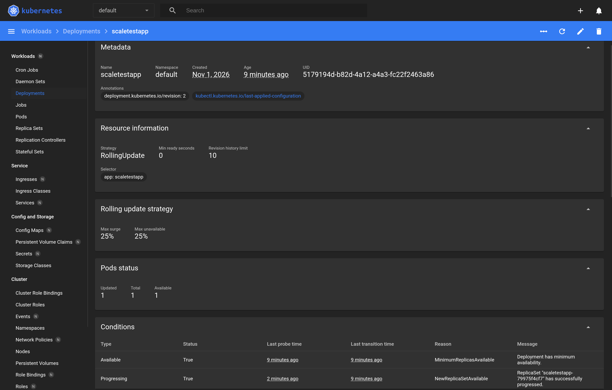

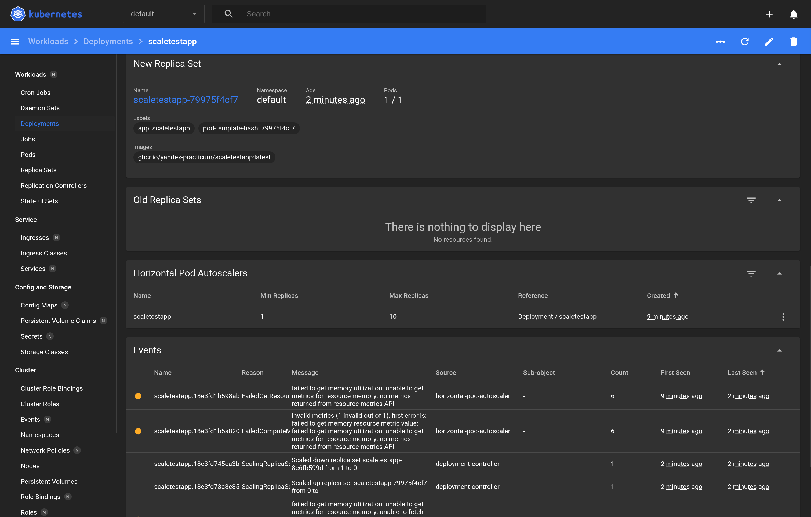

Под нагрузкой:

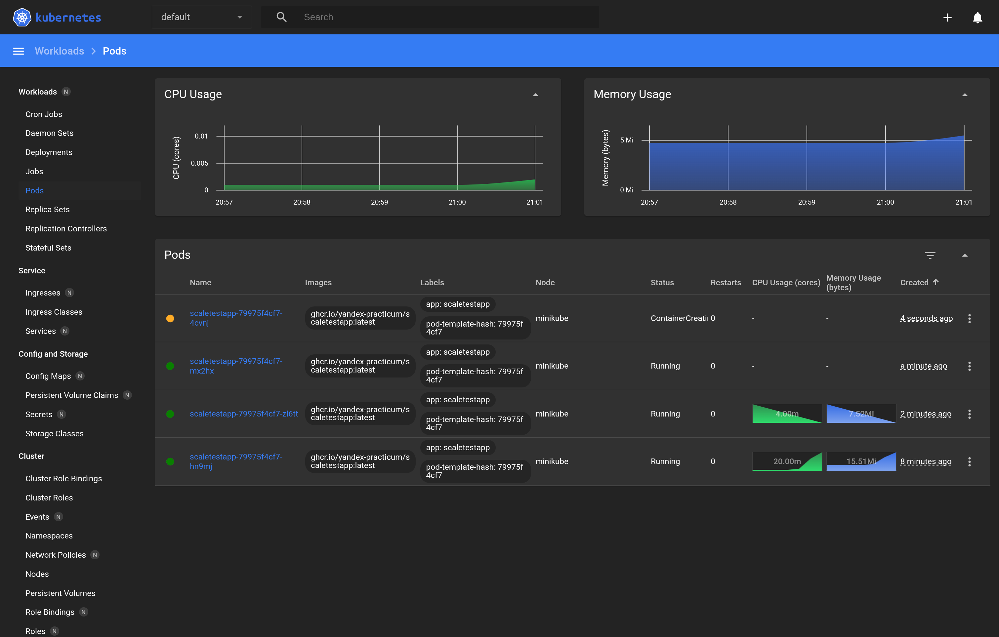

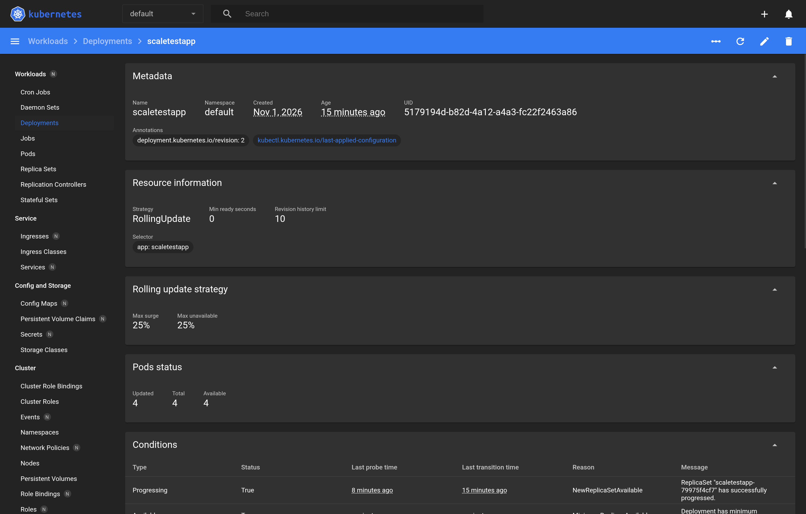

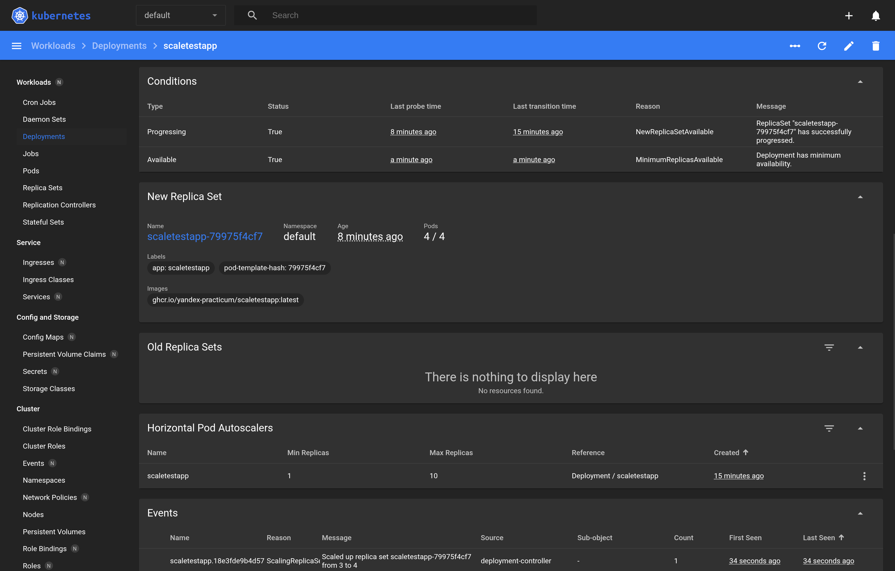

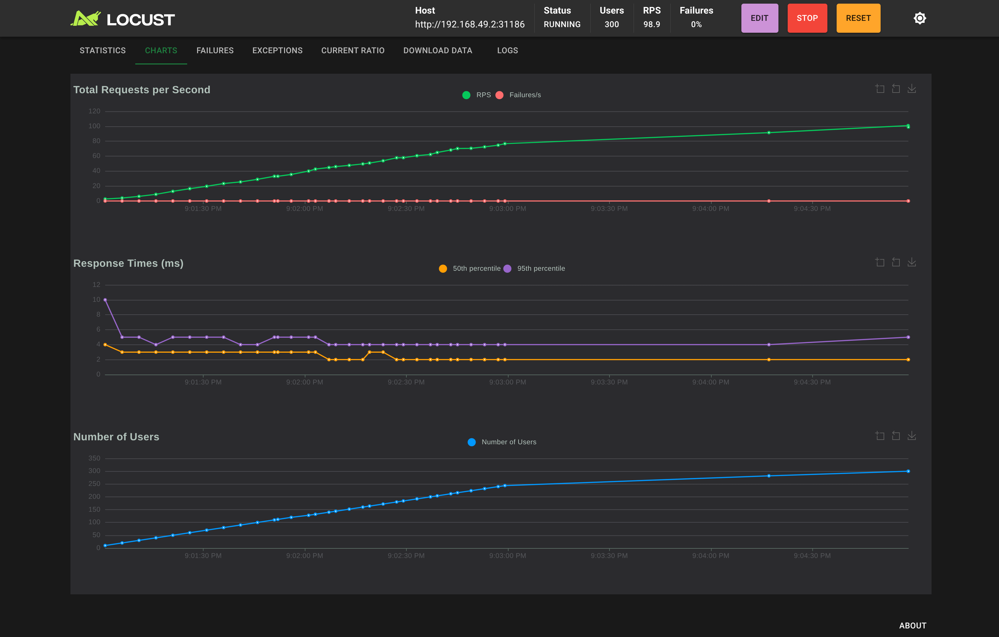

### Часть 2

Prometheus собирает метрику приложения:

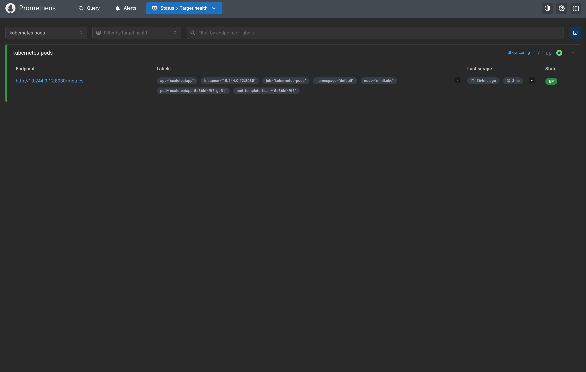

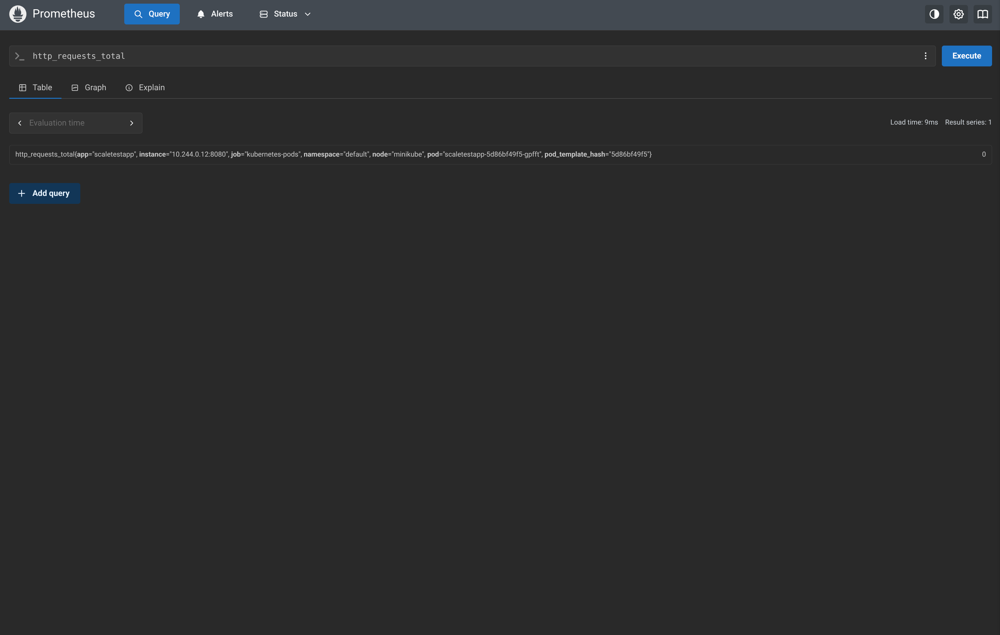

Нагрузка около 67 RPS без ошибок. Средний RPS на под дошёл до 31,9 при цели 10, HPA увеличил число реплик с 1 до 7, после чего на под приходилось около 9,5 RPS. Значения в логе в тысячных долях: `9530m` означает 9,53 RPS. Из [part2-hpa.log](part2-hpa.log):

```text
21:19:37  0/10        replicas 1
21:20:23  12327m/10   replicas 1
21:20:38  22605m/10   replicas 2
21:20:53  31933m/10   replicas 3
21:21:23  17685m/10   replicas 5
21:21:54  13197m/10   replicas 7
21:23:10  9530m/10    replicas 7

Normal  SuccessfulRescale  New size: 2; reason: pods metric http_requests_per_second above target
Normal  SuccessfulRescale  New size: 3; reason: pods metric http_requests_per_second above target
Normal  SuccessfulRescale  New size: 5; reason: pods metric http_requests_per_second above target
Normal  SuccessfulRescale  New size: 7; reason: pods metric http_requests_per_second above target
```

До нагрузки:

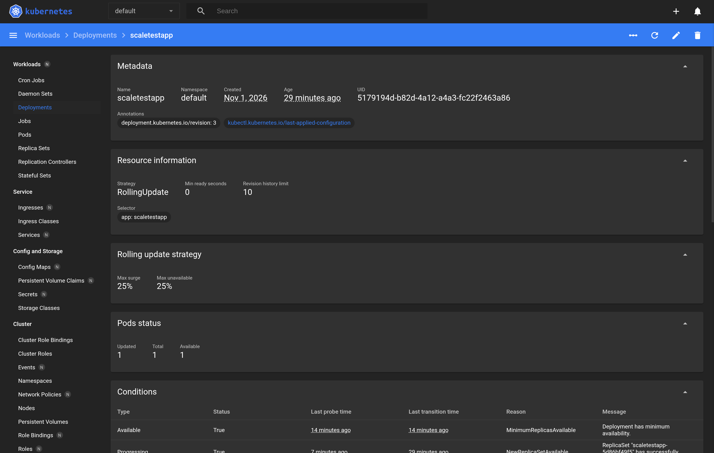

Под нагрузкой:

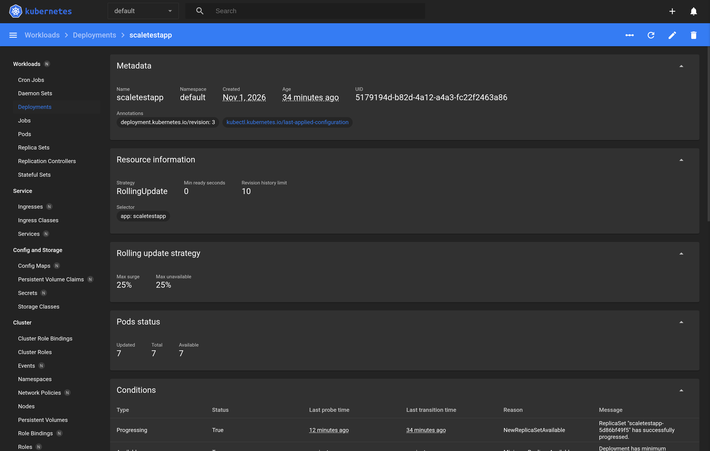

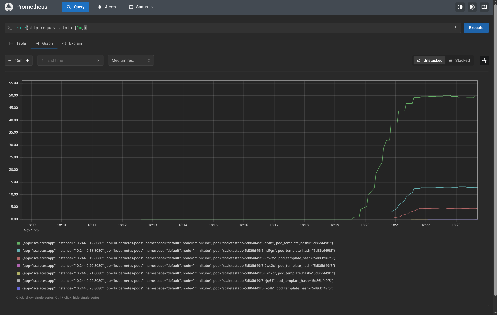

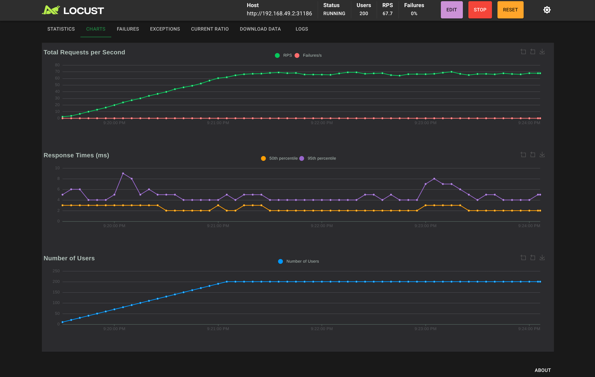
